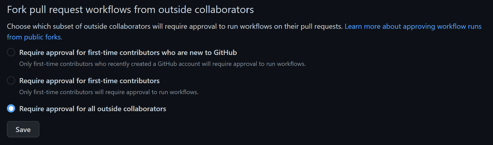

# activate-unity-license

A GitHub Action to activate a [Unity Game Engine](https://unity.com) license for CI/CD workflows.

## How to use

This action uses your stored environment secrets to authenticate with the Unity Licensing servers.

***It's important that you disable other forks of your repository to run actions in pull requests from unknown contributors.***

> Read more on [Approving workflow runs from public forks](
https://docs.github.com/en/actions/managing-workflow-runs/approving-workflow-runs-from-public-forks)

[](https://docs.github.com/en/repositories/managing-your-repositorys-settings-and-features/enabling-features-for-your-repository/managing-github-actions-settings-for-a-repository)

### inputs

This action requires several secrets that need to be setup in the repository or organization's action secret store.

* `UNITY_USERNAME`: The ***email address*** you use for your Unity Id.
* `UNITY_PASSWORD`: The ***password*** you use for Unity Id access.
* `UNITY_SERIAL`: The ***Serial number*** for the seat.
* `UNITY_SERVICES_CONFIG`: Unity License Client `services-config.json` encoded as base64 string.

> [!IMPORTANT]
> Don't forget that Professional licenses only support 2 activations at a time!

| name | description | required |
| ---- | ----------- | -------- |
| `license` | Must be one of `personal`, `professional`, or `floating`. | Defaults to `personal` |
| `username` | The ***email address*** you use for your Unity Id | Required for `personal`, `professional` license activations |
| `password` | The ***password*** you use for Unity Id access | Required for `personal` and `professional` license activations |
| `serial` | The ***Serial number*** for the seat | Required for `professional` license activations, but not named seats. |
| `configuration` | Unity License Client `services-config.json` path, raw json, or json encoded as base64 string. | Required for `floating` license activations |
| `return-license` | When the post step returns the license: `auto`, `always`, or `never`. | Defaults to `auto` |
| `license-version` | ***Deprecated***, the license version is detected from the installed editor. | No |

### license return

With `return-license: auto`, the post step returns the license when the job ends, except a `personal` license on GitHub-hosted macOS and Linux runners. Those runners share one machine identity with Unity, so a return there revokes the license for every other job on that identity, other repositories' included.

| runner | `personal` | `professional` | `floating` |
| ------ | ---------- | -------------- | ---------- |
| GitHub-hosted Windows | returned | returned | released |
| GitHub-hosted macOS and Linux | ***not returned*** | returned | released |
| self-hosted | returned | returned | released |

`always` returns the license on every runner, and `never` keeps it on every runner. Floating licenses always release their lease.

### seat usage

Each paid seat allows 2 activations, and every GitHub-hosted macOS job shares one machine identity, as does every Linux job. A `professional` license that isn't returned keeps holding one of those activations, and a runner image update can change the identity and orphan it. When activations run out, activation fails and the action warns. Release them at [id.unity.com](https://id.unity.com) under ***My Seats***.

### cached license file

Set the `UNITY_LICENSE` environment variable to a `Unity_lic.ulf` path, its raw XML, or base64 to activate from a license file activated earlier on a machine with the same identity. The action signs in with the account when the file can't be used.

### workflow

```yaml
steps:
  - uses: RageAgainstThePixel/activate-unity-license@v3
    with:
      license: 'Personal' # Choose license type to use [ Personal, Professional, Floating ]
      username: ${{ secrets.UNITY_USERNAME }}
      password: ${{ secrets.UNITY_PASSWORD }}
      # serial: ${{ secrets.UNITY_SERIAL }} # Required for pro activations
      # configuration: ${{ secrets.UNITY_SERVICES_CONFIG }} # Required for floating license activations
```

### upgrading from v2

* A `personal` license is no longer returned on GitHub-hosted macOS and Linux runners; use `return-license` to change it.
* `license-version` is ignored; 4.x and 5.x licenses are detected from the editor installed by an earlier step.
* Activation goes through the official Unity CLI first, then the Unity Licensing Client; Unity Hub is no longer required.
